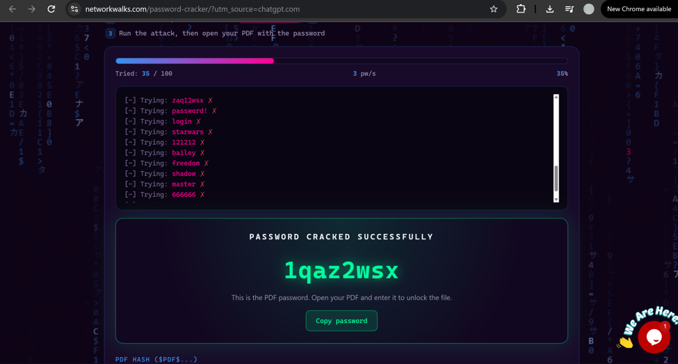
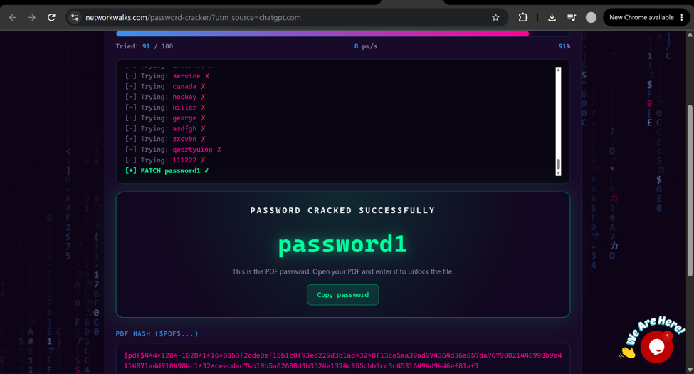

# 🔐 PM2 — Password Recovery Using NetworkWalks Tools

## 📌 Project Overview

As part of Week 3 of my NetworkWalks Cybersecurity Internship, I explored browser-based password recovery using the NetworkWalks Hash Calculator and Password Cracker.

The practical exercise involved extracting password-verification hashes from authorized training PDF files, performing dictionary attacks, and verifying recovered passwords.

## 🎯 Objectives

- Understand how password hashes are used in password recovery.
- Explore browser-based password-auditing tools.
- Extract hashes from password-protected PDF files.
- Perform dictionary-based password recovery.
- Verify successful password recovery.
- Document the process and results.

## 🛠️ Tools Used

| Tool | Purpose |
|------|---------|
| NetworkWalks Hash Calculator | Extract PDF password hashes |
| NetworkWalks Password Cracker | Perform password-recovery attacks |
| Web Browser | Access the online tools |
| Training PDF Files | Authorized password-recovery targets |

## ⚙️ Implementation

### Step 1 — Accessing the Tools

I accessed the NetworkWalks browser-based tools:

- [Hash Calculator](https://networkwalks.com/hash-calculator/)
- [Password Cracker](https://networkwalks.com/password-cracker/)

### Step 2 — Extracting PDF Hashes

I uploaded the authorized password-protected training PDFs using the PDF functionality of the Hash Calculator.

The tool generated password-verification hashes that could be used for password-recovery testing.

### Step 3 — Performing a Dictionary Attack

I copied the extracted PDF hashes into the NetworkWalks Password Cracker and started dictionary-based attacks.

A dictionary attack tests candidate passwords from a predefined list against a password hash.

The tool displayed progress while testing possible passwords.

### Step 4 — Recovering Passwords

The password-recovery tool displayed successful results for the documented training exercises.

After recovery, I used the passwords to verify access to the corresponding protected PDF files.

## 📸 Screenshots and Evidence

### Dictionary Attack in Progress

The password cracker displaying attack progress at 91%.

### Successful Password Recovery — Result 1

The tool displaying a successful password-recovery result.

### Successful Password Recovery — Result 2

Another successful password-recovery result.

## 🧠 Key Learning Outcomes

Through this exercise, I learned how to:

- Extract password-verification hashes from training PDFs.
- Use browser-based password-auditing tools.
- Understand dictionary attacks.
- Monitor password-recovery progress.
- Interpret successful recovery results.
- Recognize the importance of strong and unpredictable passwords.

## ⚖️ Ethical Considerations

All exercises were performed on authorized training PDF files for educational purposes.

Password-recovery tools should only be used on files and systems that I own or have explicit permission to test.

---

**Internship:** NetworkWalks Cybersecurity Internship  
**Module:** PM2 — NetworkWalks Password Cracker  
**Week:** 3
